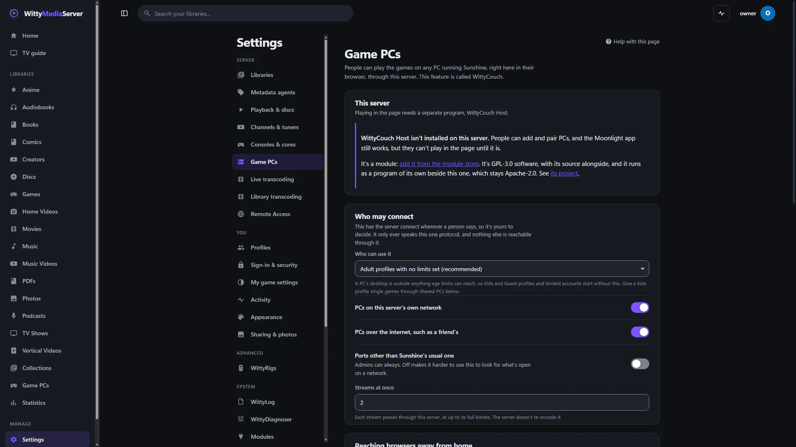

# WittyCouch Host

The separate program that carries WittyCouch's game streams: Moonlight's streaming core as a small program of its own. You need it to play through WittyCouch, and it's added for you.

It isn't made by the Moonlight or Sunshine projects. It's built on Moonlight's code, whose authors did the hard part.

<!-- pictures -->



<sub>This host has no screens of its own: this is where a server adds a PC running it. Settings, Game PCs, on a server with none added yet.</sub>

<!-- /pictures -->

## What it does

WittyMediaServer starts it for each game stream and talks to it over stdin and stdout, using the messages in [PROTOCOL.md](PROTOCOL.md). It connects to a PC running Sunshine, and passes on whole video frames and audio packets without decoding them.

A stream comes from someone else's computer, and this program parses it in C, so it's treated as if it might be taken over:

- It's started with an empty environment, with no addresses or keys on its command line.
- What it sends is treated as untrusted by the program that started it, with limits on every message.
- On Linux it can't gain privileges, it's limited to no files (Landlock where the kernel has it), and it dies with its parent.
- On Windows the server runs it at low integrity, and it loads DLLs only from Windows' own folder.
- It's built with stack protection and for address randomisation. Mbed TLS is cut down to the AES it needs, with no certificates, parsers or file access.

No games come with it.

How to use it is in **Help** inside WittyMediaServer: see Game PCs.

## How to get it

Adding [WittyCouch](https://github.com/wittywilla/WittyCouch) from the module store brings it: **Settings → Modules**, then **Browse the store**. **Settings → Modules** then lists it under **Installed separately**. That needs WittyMediaServer 0.6.0-alpha or later, and works with nothing older. The range this version fits is in `module.json`: 0.6.0-alpha through 0.8.x, so WittyMediaServer 0.8.0-alpha included.

Every release carries `wittycouch-host-<version>-source.tar.gz` beside its programs, with this program and every dependency at its exact commit, listed in `third_party/COMMITS.txt`. It builds with no network.

## What it needs

A PC running Sunshine to connect to. The programs need nothing installed: Linux releases are static with musl, Windows needs only DLLs that are part of Windows, and macOS builds link only what's part of macOS 11 or newer.

## Platforms

| System | Where it stands |
|---|---|
| Windows x64 | Has taken real streams from a real Sunshine |
| Linux x64 | Has taken real streams from a real Sunshine, in both the static and the glibc build |
| Linux arm64 | Built, and run with `--version` under emulation only |
| macOS (Intel, Apple silicon) | Only built by the release workflow, and that has not run yet. It has never been run |
| FreeBSD | **No build.** On FreeBSD the store says so in place of **Add**, and WittyCouch's streaming isn't available |
| 32-bit Linux, Windows on arm64 | No build |

## Building and testing

One command fetches everything at its pinned commit and leaves a single file in `dist/`:

```bash
sh scripts/build.sh linux-x64
```

The target is `windows-x64`, `linux-x64`, `linux-arm64`, `macos-x64` or `macos-arm64`. With no target, it builds for the computer it's on. `dist/wittycouch-host-<target> --version` says it runs. It needs CMake, git, and a C and C++ compiler.

| Target | Build on | Needs | Result |
|---|---|---|---|
| `windows-x64` | Linux, cross-compiling | `g++-mingw-w64-x86-64` (Debian, Ubuntu) | One `.exe` |
| `linux-x64`, `linux-arm64` | Alpine | `build-base cmake linux-headers git` | Static with musl, so it runs on any Linux, the server's Docker image included |
| `linux-x64`, `linux-arm64` | Another Linux | `g++`, or `g++-aarch64-linux-gnu` to cross-compile for arm64 | Links that system's glibc, and needs that version or newer |
| `macos-x64`, `macos-arm64` | macOS | Xcode's command line tools, CMake | Links only what's part of macOS |

To build on Alpine from any computer with Docker, in this folder:

```bash
docker run --rm -v "$PWD:/src" -w /src alpine:3.24 sh -ec 'apk add --no-cache build-base cmake linux-headers git; git config --global --add safe.directory "*"; sh scripts/build.sh linux-x64'
```

Two CMake options, for building some other way. `-DUSE_MBEDTLS=OFF` links the system's OpenSSL (Apache-2.0, from version 3) instead of Mbed TLS, and needs its development files. `-DWITTY_STATIC=ON` builds the C library in, and is for musl: built into a binary, glibc's licence (LGPL-2.1) would need its source offered with it too.

[`.github/workflows/release.yml`](.github/workflows/release.yml) builds all of them on every push, and publishes a release for a `v*` tag.

## Licence

**AGPL-3.0-or-later** for this project's own code: see [LICENSE](LICENSE). The Moonlight-derived parts (moonlight-common-c, fetched at build time) stay GPL-3.0: see [LICENSE.GPL-3.0](LICENSE.GPL-3.0), and the combined binary is distributed under terms satisfying both (GPLv3 §13 / AGPLv3 §13). What's built into it, each checked against its own licence file at the commit pinned in [`scripts/fetch-core.sh`](scripts/fetch-core.sh):

| What | Licence | In which builds |
|---|---|---|
| [moonlight-common-c](https://github.com/moonlight-stream/moonlight-common-c) | GPL-3.0 | All |
| [ENet](https://github.com/cgutman/enet), Moonlight's version of it | MIT | All |
| [nanors](https://github.com/sleepybishop/nanors), with its obl library | MIT | All |
| [Mbed TLS](https://github.com/Mbed-TLS/mbedtls) 3.6.7 | Apache-2.0, chosen from its dual Apache-2.0 / GPL-2.0-or-later | All, unless built with `-DUSE_MBEDTLS=OFF` |
| [musl](https://musl.libc.org) | MIT | Linux releases |
| [mingw-w64](https://www.mingw-w64.org)'s runtime | ZPL-2.1, with some parts public domain and some under the permissive notices in NOTICE | Windows |
| GCC's runtime libraries (libgcc, libssp) | GPL-3.0 with the GCC Runtime Library Exception | Linux releases and Windows |

Mbed TLS's own third-party code (Everest, p256-m) isn't used: this program's settings leave it out. [NOTICE](NOTICE) credits the authors, and carries the licence texts they ask to have kept with a binary.

It's a separate program. WittyMediaServer, WittyCouch and its browser client are AGPL-3.0-or-later and don't contain or link any of this. They only exchange the messages in [PROTOCOL.md](PROTOCOL.md), which anyone can implement.

## Legal

WittyCouch Host is an independent open-source project, AGPL-3.0-or-later, built on Moonlight's code under the GPL-3.0. It
isn't associated with, sponsored by or endorsed by the Moonlight or Sunshine projects, NVIDIA, or any
game publisher. No games come with it. Any third-party names here only describe what it works with, and
belong to their owners. It's provided “as is”, with no warranty; see [LICENSE](LICENSE). Local law
applies to how you use it. This isn't legal advice.

<!-- module-kit -->
## Releasing

A version tag builds a program for every platform, signs the checksum list, and publishes a release that servers can install.

Versions move in small steps as work lands. `go run github.com/wittywilla/wittymodule/cmd/wittymodule@v0.3.0 bump .` raises it
everywhere it is written (add `-part minor` for a bigger step). A bump isn't a release: nothing is
tagged or published until you tag it. CI fails when code changed since the last tag and the version
didn't, because tags never move.

To release:

1. Check that `version` in `module.json` is the one to publish, with the bump committed.
2. Tag that commit and push the tag: `git tag vX.Y.Z`, then `git push origin vX.Y.Z`. A tag with a
   suffix, such as `v1.2.0-beta`, is published as a prerelease.
3. Watch the *Actions* tab. The signing step uses the `WMS_SIGNING_KEY` secret of the `release` environment, and nothing is published without it.

To take a version back, run the *withdraw* workflow from the *Actions* tab. It adds the version to a signed list on the release tagged `withdrawals`, which servers read.

Licensed under AGPL-3.0-or-later, with Moonlight-derived parts under GPL-3.0: see [LICENSE](LICENSE), [LICENSE.GPL-3.0](LICENSE.GPL-3.0) and [NOTICE](NOTICE).
<!-- /module-kit -->
